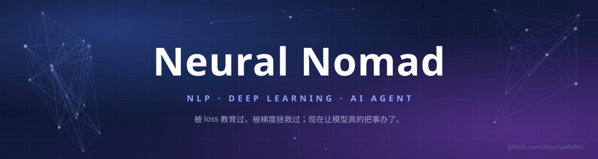

  
  

### 你好，我是 Neural Nomad 👋

> 被 loss 教育过，被梯度拯救过。

- 🔭 **现在在折腾**：把 RAG 和 Agent 从 demo 推到能跑的系统——检索、重排、工具调用、失败重试、记忆
- 🌱 **关注**：Agent 规划（Planning）/ 工具调用（Tool Use）/ 记忆（Memory）/ RAG / LLM 评测
- 🎯 **目标**：AI Agent · LLM 应用工程师
- 📍 北京

---

### 🛠 Tech Stack

---

### 🚀 精选项目

| 项目 | 一句话 | 技术栈 |
|:--|:--|:--|
| [**RAG-Knowledge-Base**](https://github.com/neural-nomad-lee?tab=repositories) | 企业知识库问答：混合检索 + 重排 + 引用溯源 | Python · Milvus · bge · FastAPI |
| [**Agent-Workflow**](https://github.com/neural-nomad-lee?tab=repositories) | 多步任务 Agent：规划、工具调用、失败重试与记忆 | LangGraph · Function Calling |
| [**LLM-Finetune-Lab**](https://github.com/neural-nomad-lee?tab=repositories) | 指令微调与评测流水线 | LoRA · vLLM · evals |

<!-- TODO: 三个项目链接先指向仓库列表；建好仓库后换成各自仓库地址 -->

---

### 📊 GitHub

  
  

  

<!-- 统计卡依赖 vercel 系服务，国内访问慢可整块删除，不影响其它内容 -->

---

### 📚 最近在读

- 《深入理解 AI Agent：设计原理与工程实践》
- ReAct · Reflexion · Toolformer · Self-RAG

---

### 📫 找到我

  
   
  Last updated: 2026-11-05 · 持续训练中

